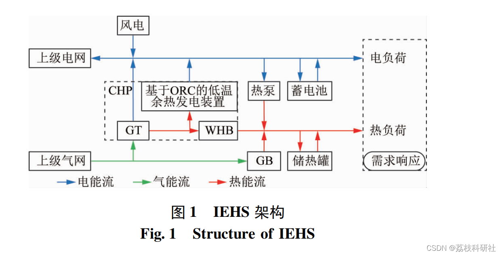
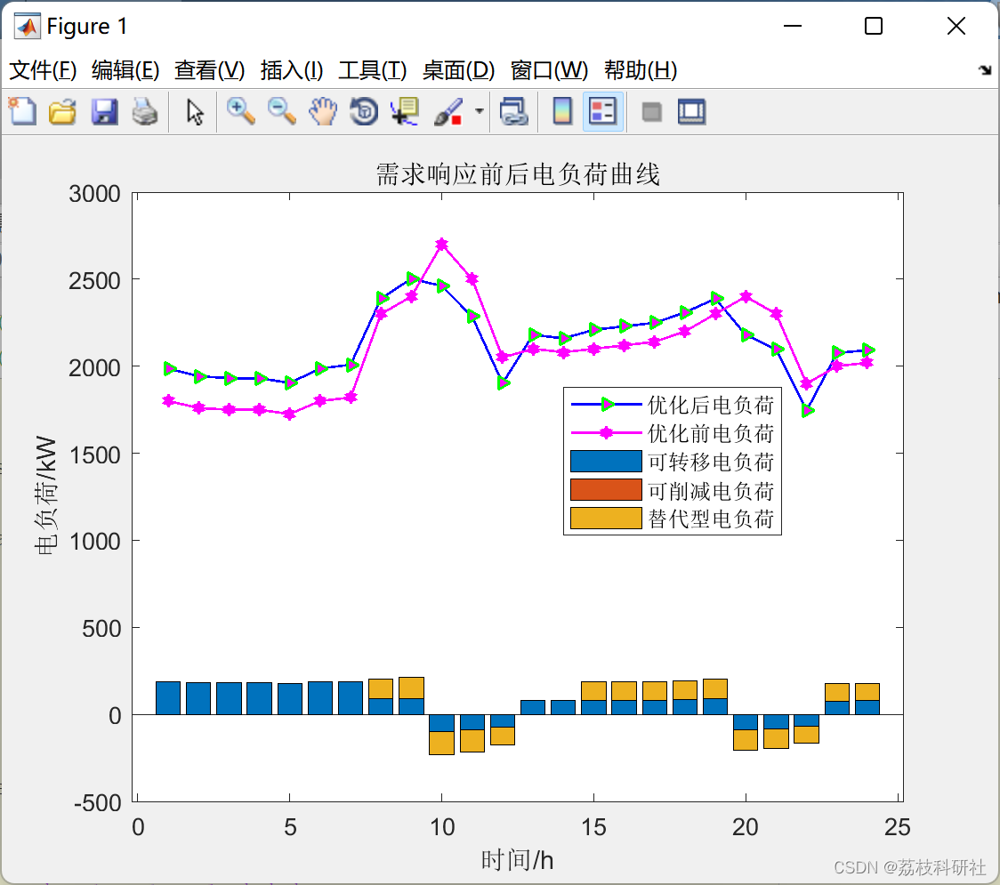
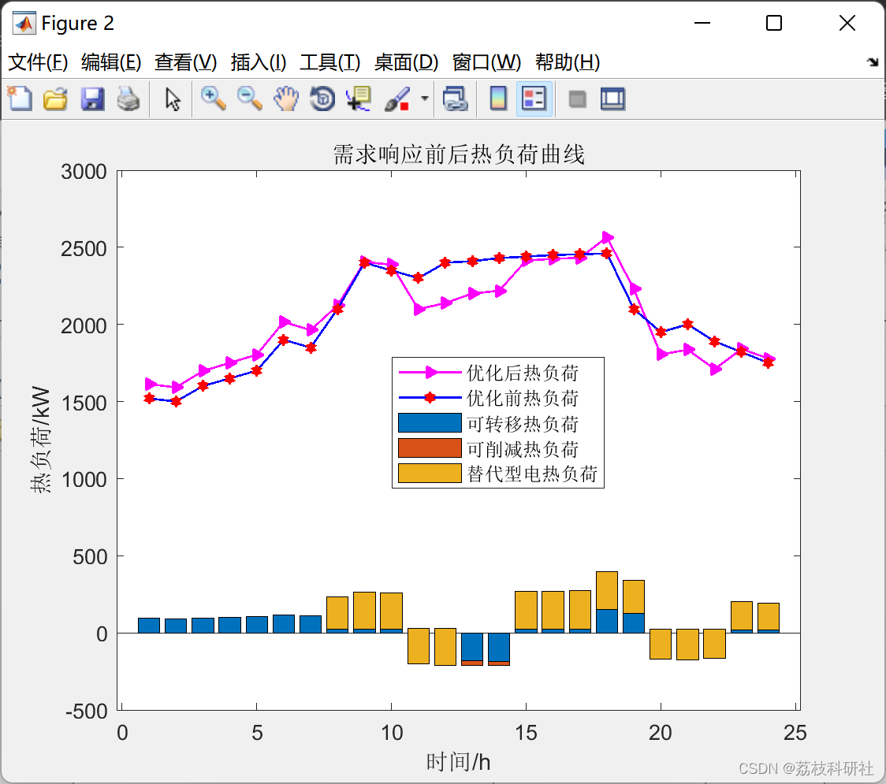
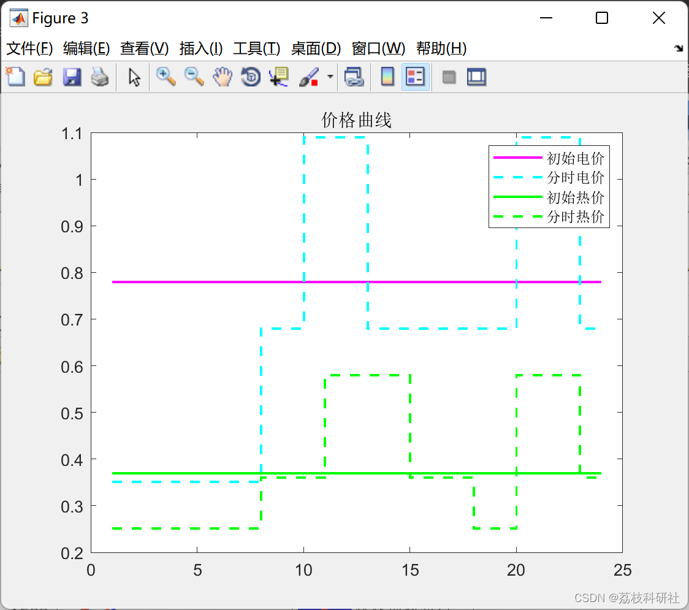
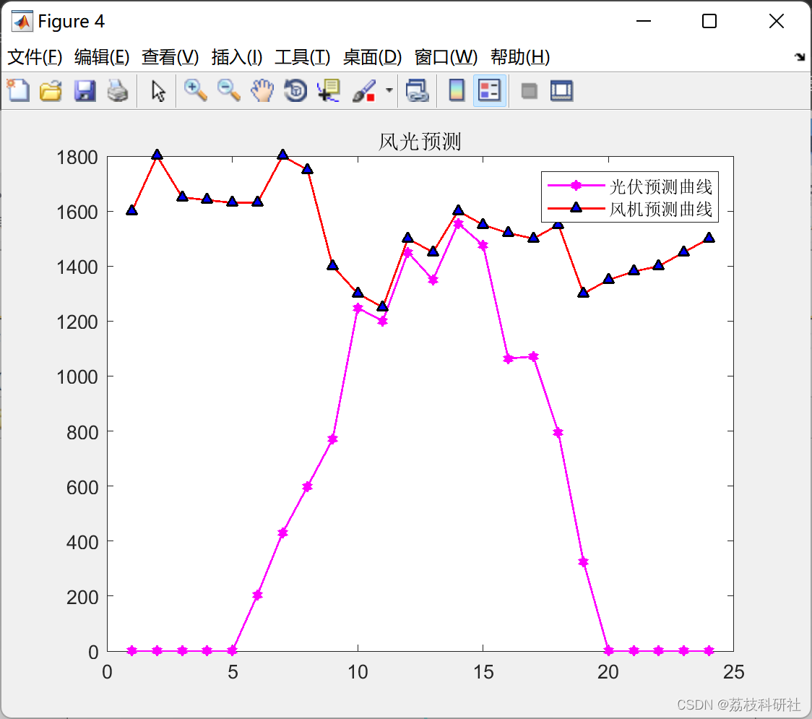
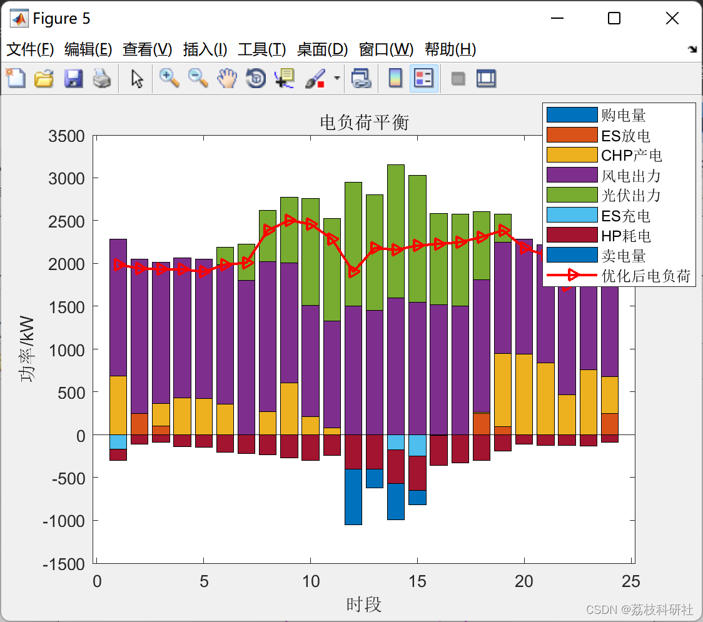
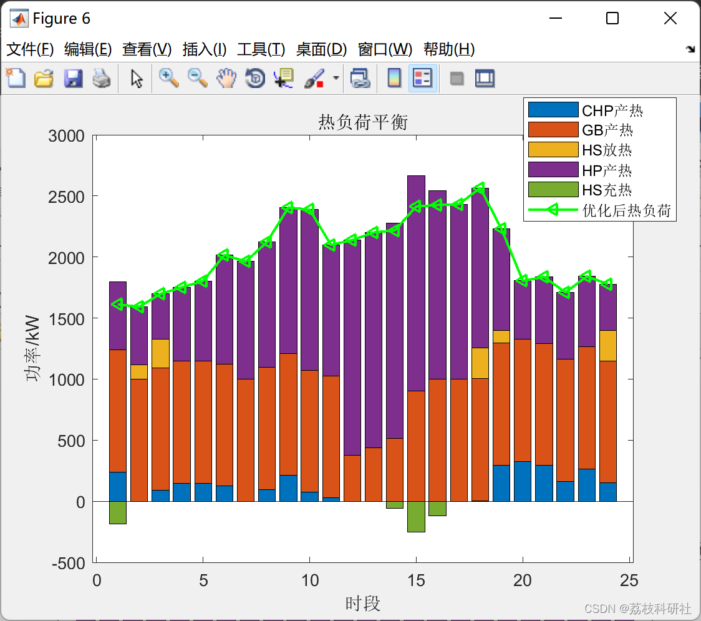

# Optimization Operation of Comprehensive Energy System under Carbon Trading Mechanism Considering Demand Response (Matlab Code Implementation)

Carbon trading mechanism, considering demand response for comprehensive energy system optimization operation (Matlab code implementation)

Edited by:
Edited by:
📚2 Running Results
To verify the rationality of the proposed model, this paper conducts a comparative analysis on four scenarios. Scenario 1: Considering only the carbon trading mechanism; Scenario 2: Considering demand response under the carbon trading mechanism; Scenario 3: Considering only demand response; Scenario 4: Not considering either the carbon trading mechanism or demand response. 2.1 Scenario 2: Carbon trading mechanism considering demand response
Edited by:
Edited by:
Edited by:
Edited by:
Due to space constraints, this paper only presents the results of Scenario 2 in part 2.1, with details available in part 3. The simplicity of Scenario 2 is evident.
2.2 Scenario 1: Considering only the carbon trading mechanism
2.3 Scenario 3: Considering only demand response
2.4 Scenario 4: Not considering either the carbon trading mechanism or demand response
🎉4 References
Edited by:

## Images

<!-- PAYMENT_BLOCK -->

## Get this dataset

- Payment link (Stripe): [Buy now](https://buy.stripe.com/3cs8yP7sY87d0vu9AB)
- Payment QR code: 

<!-- /PAYMENT_BLOCK -->
